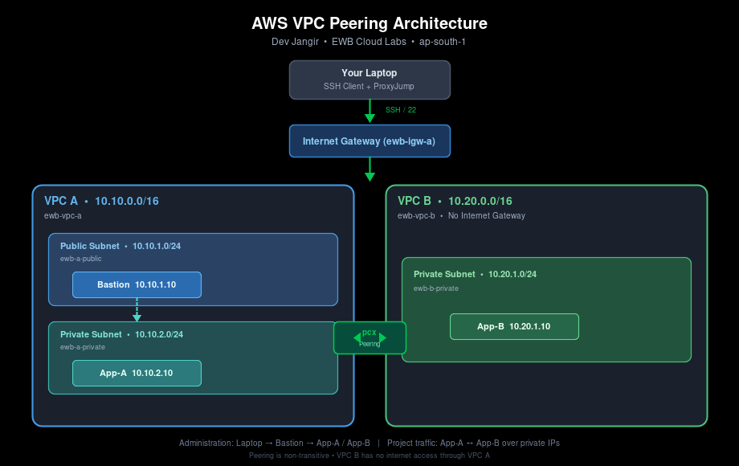

# AWS VPC Peering Project

**Student:** Dev Jangir  
**Location:** Jaipur  
**Batch:** Batch 1  
**Course:** AWS Architect Associate – EWB Cloud Labs  
**Region:** ap-south-1 (Mumbai)  
**Completion Date:** 19 October 2026  

---

## Project Overview

This project demonstrates a working **VPC Peering** connection between two private workloads running in separate VPCs.  

- **VPC A** (`10.10.0.0/16`) contains a public bastion host and a private application server (App-A).  
- **VPC B** (`10.20.0.0/16`) contains a private application server (App-B) with **no internet gateway**.  
- Both application servers remain private (no public IPv4).  
- Administrative access is provided only through a bastion host using **SSH ProxyJump**.  
- Application traffic between App-A and App-B flows over private IPs across the peering connection.

---

## Architecture

### High-level flow

| Path | Description |
|------|-------------|
| **Administration** | Laptop → Internet Gateway → Bastion (public subnet) → App-A or App-B (via ProxyJump) |
| **Project traffic** | App-A ↔ App-B using private IPv4 addresses over the VPC Peering connection (`pcx`) |

> Peering is non-transitive. VPC B cannot use VPC A’s internet gateway.

---

## Address Plan

| Resource / Name tag       | VPC / Subnet              | IPv4 CIDR / Address              |
|---------------------------|---------------------------|----------------------------------|
| ewb-vpc-a                 | VPC A                     | 10.10.0.0/16                     |
| ewb-a-public              | VPC A / public subnet     | 10.10.1.0/24                     |
| ewb-a-private             | VPC A / private subnet    | 10.10.2.0/24                     |
| ewb-vpc-b                 | VPC B                     | 10.20.0.0/16                     |
| ewb-b-private             | VPC B / private subnet    | 10.20.1.0/24                     |
| ewb-bastion               | ewb-a-public              | 10.10.1.10 + public IPv4         |
| ewb-app-a                 | ewb-a-private             | 10.10.2.10 (no public IP)        |
| ewb-app-b                 | ewb-b-private             | 10.20.1.10 (no public IP)        |

---

## Key Resources Created

| Resource Type          | Name Tag              | Notes                                      |
|------------------------|-----------------------|--------------------------------------------|
| VPC                    | ewb-vpc-a, ewb-vpc-b  | Non-overlapping CIDRs                      |
| Subnets                | ewb-a-public, ewb-a-private, ewb-b-private | Explicit route table associations |
| Internet Gateway       | ewb-igw-a             | Attached only to VPC A                     |
| Route Tables           | ewb-rt-a-public, ewb-rt-a-private, ewb-rt-b-private | Peer routes added in both directions |
| Security Groups        | ewb-sg-bastion, ewb-sg-app-a, ewb-sg-app-b | Least-privilege inbound rules only |
| Peering Connection     | ewb-a-b-peer          | Same account, same Region, Active status   |
| EC2 Instances          | ewb-bastion, ewb-app-a, ewb-app-b | Amazon Linux 2023, t3.micro |
| Key Pair               | ewb-lab               | Used for all three instances               |

---
## What Was Demonstrated

- [x] Non-overlapping VPC and subnet CIDRs  
- [x] Public + private subnets with explicit route table associations  
- [x] VPC Peering request → Accept → Active  
- [x] Forward and return routes on both sides  
- [x] Security group rules scoped to individual lab hosts only  
- [x] Baseline failure (before peering)  
- [x] Successful two-way private connectivity (ping)  
- [x] Private SSH to App-B through bastion (ProxyJump)  
- [x] Controlled failure (remove ICMP rule → restore)  
- [x] Full cleanup of all lab resources  

---

## Security Group Summary

| Security Group     | Port / Protocol      | Source                  | Purpose                  |
|--------------------|----------------------|-------------------------|--------------------------|
| ewb-sg-bastion     | TCP 22 (SSH)         | My public IP /32        | Laptop → Bastion         |
| ewb-sg-app-a       | TCP 22 (SSH)         | 10.10.1.10/32           | Bastion → App-A          |
| ewb-sg-app-a       | ICMP Echo Request    | 10.20.1.10/32           | App-B → App-A            |
| ewb-sg-app-b       | TCP 22 (SSH)         | 10.10.1.10/32           | Bastion → App-B          |
| ewb-sg-app-b       | ICMP Echo Request    | 10.10.2.10/32           | App-A → App-B            |

---

## Important Design Points

1. **Return route is mandatory** – Without a route back from VPC B to VPC A, replies are dropped.  
2. **App-B sees the bastion’s private IP** – Because ProxyJump makes the bastion the actual client.  
3. **Active peering ≠ working connectivity** – Routes + security groups must also be correct.  
4. **VPC B cannot use VPC A’s IGW** – Peering does not support edge-to-edge routing / is non-transitive.

---

## Project Report

Full submission report (detailed evidence, explanations, cleanup proof):

📄 **[DevJangir_EWB_VPC_Peering.pdf](report/DevJangir_EWB_VPC_Peering.pdf)**

---

## Cleanup

All resources created for this lab were terminated / deleted after evidence collection:

- EC2 instances + EBS volumes  
- Peering connection + peer routes  
- Security groups, subnets, route tables, internet gateway  
- Both VPCs  
---
# Thank You
